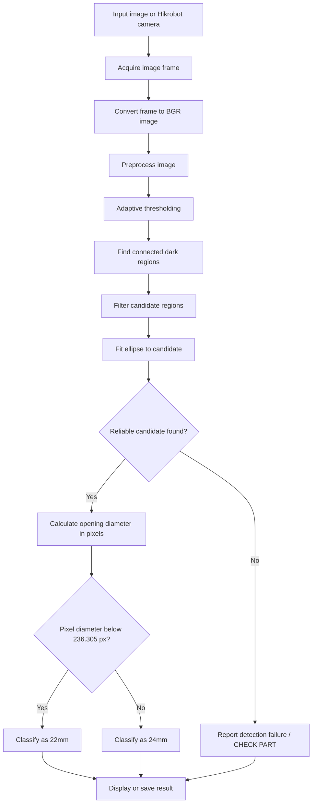
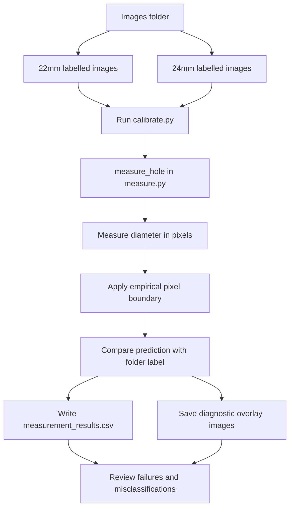
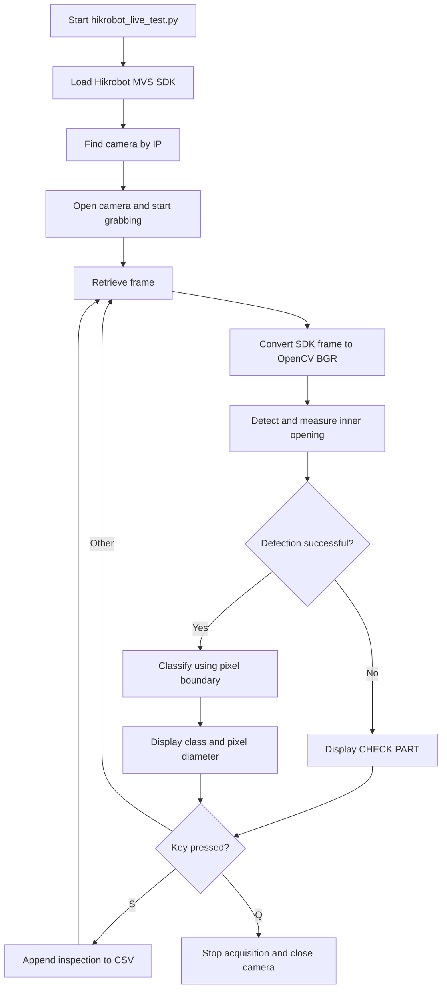

# Hole Diameter Inspection System

A Python and OpenCV computer-vision project for detecting the inner opening of a mechanical part and classifying it into **22 mm** or **24 mm** categories. The project supports offline image testing and live image acquisition from a Hikrobot camera through the MVS SDK.

> **Important validation note:** The current image classifier uses an empirical pixel-diameter boundary derived from a small labelled image set. It is not yet a validated physical measurement system. Keep camera distance, angle, focus, and lighting consistent, and validate against new parts before using the output for production decisions.

## Features

- Detects the dark inner opening using OpenCV image processing.
- Estimates opening diameter in pixels from a fitted ellipse.
- Classifies the measured opening into `22mm`, `24mm`, or `CHECK PART` in the live workflow.
- Processes labelled image folders and saves diagnostic overlays and a CSV report.
- Supports live image acquisition from a Hikrobot camera using the MVS SDK.
- Saves manually triggered live inspection results to CSV.

## How it works

### System workflow



### Offline image evaluation workflow



### Live camera workflow



## Project structure

The main files used in the current workflow are:

```text
Hole Diameter Live Demo/
├── images/
│   ├── 22mm/                    # Labelled 22 mm sample images
│   └── 24mm/                    # Labelled 24 mm sample images
├── output/
│   ├── diagnostics/             # Offline diagnostic overlays
│   ├── measurement_results.csv  # Offline classification report
│   └── live_inspection_results.csv
├── src/
│   ├── calibrate.py             # Offline image evaluation
│   ├── config.py                # Project configuration
│   ├── hikrobot_live_test.py    # Hikrobot live inspection
│   └── measure.py               # Inner-opening detector
└── README.md
```

Other scripts may exist in `src/`; the list above highlights the main files in the documented workflow.

## Requirements

- Windows
- Python 3.11 (the project environment shown during development used Python 3.11)
- OpenCV (`cv2`)
- NumPy
- Hikrobot camera and MVS SDK for live-camera operation
- Labelled BMP/JPG/PNG/TIFF images for offline testing

Install the Python packages in your active environment:

```powershell
python -m pip install opencv-python numpy
```

The Hikrobot SDK is vendor software and must be installed separately. The live script must be configured with the correct SDK and DLL paths for your computer.

## Configuration

The current live script uses these machine-specific settings:

```python
DLL_DIR = r"C:\Program Files (x86)\Common Files\MVS\Runtime\Win64_x64"
SDK_DIR = r"D:\MVS\Development\Samples\Python\MvImport"
CAMERA_IP = "192.168.1.20"
```

Update these values if your MVS installation or camera network settings differ. Close MVS Viewer before starting the Python live script if the viewer is already using the camera.

The current empirical classification boundary is:

```python
PIXEL_CLASSIFICATION_BOUNDARY = (211.87 + 260.74) / 2.0  # 236.305 px
```

- Below `236.305 px` → `22mm`
- At or above `236.305 px` → `24mm`

This boundary was derived from the observed medians of the current labelled images. It is specific to the camera setup and sample data; it should not be interpreted as a universal conversion from pixels to millimetres.

## Running the project

### 1. Offline image testing

From the project root in PowerShell:

```powershell
python .\src\calibrate.py
```

The script processes images from `images/22mm` and `images/24mm`, then writes the CSV report and diagnostic images under `output/`.

### 2. Live Hikrobot inspection

1. Connect and configure the Hikrobot camera.
2. Close MVS Viewer if it is using the camera.
3. Confirm the SDK and DLL paths in `src/hikrobot_live_test.py`.
4. From the project root, run:

```powershell
python -u .\src\hikrobot_live_test.py
```

Keyboard controls:

- **S** — Save the current inspection result to `output/live_inspection_results.csv`.
- **Q** — Quit and release camera resources.

A detection failure is shown as `CHECK PART`. Inspect the displayed result and confirm that the detector is following the inner opening rather than a surrounding ring.

## Current evaluation results

On the current labelled image set, the reported run produced:

| Metric | Result |
|---|---:|
| Labelled images | 26 |
| Successful measurements | 25 |
| Detection failures | 1 |
| Correct classifications among successful measurements | 25 / 25 |
| Accuracy among successful measurements | 100.00% |
| Overall success including the failed detection | 25 / 26 (96.15%) |

These are results on the current sample set, and the classification boundary was derived from that same set. They are **not an independent test of generalization**. Test on new images and actual live-camera frames before drawing conclusions about real-world accuracy.

## Limitations and next steps

- **Pixel boundary is setup-dependent.** Changes in distance, angle, focus, resolution, or camera settings can change the measured pixel diameter.
- **Physical measurement is not yet validated.** Accurate millimetre output requires a controlled setup and calibration using a known reference standard or validated dimensional measurement method.
- **Detection failures must be reviewed.** Do not silently count a failed detection as a correct classification.
- **Use independent test samples.** Keep a separate set of images that was not used to choose the classification boundary.
- **Keep the part position consistent.** A fixture can reduce variation in distance and orientation.
- **Review diagnostic overlays.** Verify that the fitted ellipse follows the inner opening for both categories.

## Troubleshooting

### The camera does not open

- Close MVS Viewer and other applications that may be using the camera.
- Confirm that the camera is reachable at the configured IP address.
- Verify the MVS SDK installation and the configured DLL/SDK paths.
- Run the script from the project's active Python environment.
- Read the full terminal traceback and SDK error code.

### The live window displays `CHECK PART`

- Ensure the inner opening is visible, focused, and not clipped.
- Keep the part and camera at the same distance and angle as the sample setup.
- Review the detection overlay or run offline testing on the corresponding image.
- Do not adjust the classification boundary just to hide a detection failure.

### VS Code shows a yellow underline on the SDK import

Pylance may not resolve the vendor SDK module statically even when the script adds the SDK path at runtime. Configure the SDK folder in the Python analysis extra paths if needed. A yellow underline alone does not establish that the script will fail at runtime.

## License

Add the license you intend to distribute this project under before publishing or accepting external contributions.
